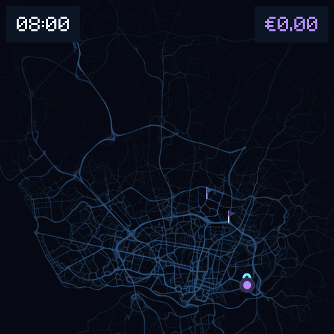

# Демо на 90 секунд

Заздалегідь: `python -m pipeline.build_game`, відкрити `game/index.html`, вибрати першу зміну (пн 08–10).

| Час | Що робимо | Що кажемо |
|---|---|---|
| 0:00 | Стартовий екран. | «Ти — Ріїн Гіслінг, таксист у Порту 2014 року. Проти тебе — найкращий реальний водій цієї зміни і 7 ланосів.» |
| 0:10 | Екран «Про дані» або [docs/STATS.md](STATS.md). | «Це справжні поїздки: 1,7 млн записів, а наш Python-конвеєр відсіяв їх, порахував зміни, привида і дорожній граф. Деталі: [docs/DATA.md](DATA.md).» |
| 0:25 | Почати зміну. Навести мишу (або торкнутися один раз) на яскраву мітку «€N». Показати маршрут: шлях пасажира до прапорця. Тоді клікнути (торкнутися вдруге) і взяти замовлення. | «Мітка світиться, поки я встигаю. Бачу маршрут, пасажира і прапорець. Беру, поки не забрав справжній водій чи ланос.» Показати бузкову машину (привид), кнопку ×3 і бронювання наступного замовлення під час поїздки. |
| 1:05 | Кінець зміни: екран результату. | «Медаль і місце серед реальних водіїв. Ось таблиця «Перегони 7 ланосів»: хто скільки заробив.» |
| 1:15 | Показати вивід `python -m pipeline.balance --strategy value --lag 200 --diff normal` (таблиця по змінах і підсумок) та дорожній граф. Вивід — у гілці `feat/a2-balance`, у `main` з'явиться після злиття: підготувати знімок заздалегідь. | «Баланс ми не вгадували: Python-бот проходить усі 28 змін за правилами гри й показує, чи чесні пороги медалей. Дороги в грі — справжній граф Порту.» |
| 1:25 | Назад до гри. | «7 ланосів: один HTML-файл, без інтернету, на справжніх даних.» |

## Якщо наживо не вийшло

1. Показати запис гри: `docs/img/replay-mon-am.gif` (або `docs/img/replay-fri-night.gif`).
2. Показати знімки `docs/img/heatmap.png`, `docs/img/hours.png` і `docs/img/shifts.png` (попит і зміни).
3. Далі за тим самим сценарієм: хук, дані, результат і «Перегони 7 ланосів», близько.

