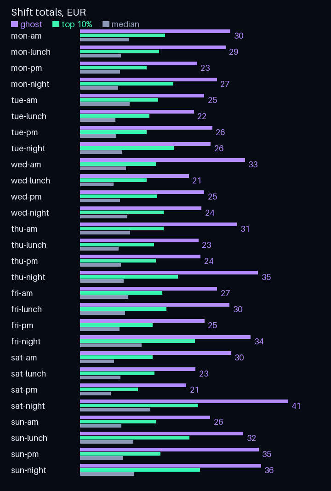
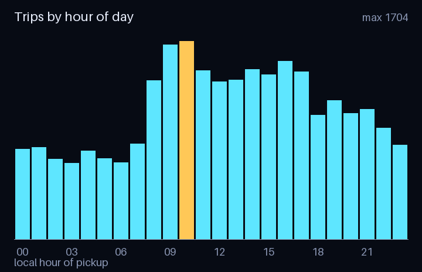
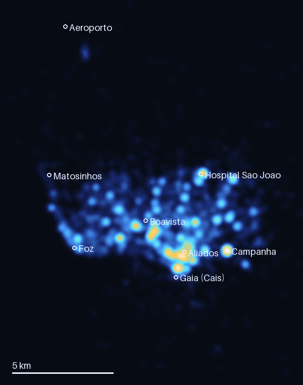

# 7 ланосів: дані тижня

Зведення з реальних поїздок Порту (UCI 339, CC BY 4.0), 12–18 травня 2014. Усе тут пораховано з даних; тариф, час ×40 та інше — вигадка гри. Файл створює `python -m pipeline.report`.

## Тиждень у цифрах

Тариф гри: €3,25 + €0,50 за км, ×1,2 вночі (22:00–05:59).

| Показник | Значення |
|---|---|
| Рядків у тижневих даних | 32 833 |
| Поїздок, що проходять фільтр гри | 26 802 |
| з них у 28 змінах гри (замовлення) | 10 105 |
| Різних таксистів | 427 |
| Пройдено, км | 137 227 |
| Середня поїздка, км | 5,12 |
| Виторг за тарифом гри | €162 938,70 |
| Середній чек | €6,08 |

## Зміни

Привид — найкращий реальний водій зміни; медіана й топ-10 % — по всіх водіях зміни.

| Зміна | Назва | Замовлень | Водіїв | Привид | Медіана | Топ-10 % | Складність |
|---|---|---|---|---|---|---|---|
| `mon-am` | Понеділковий ранок | 506 | 293 | €29,72 | €9,63 | €16,78 | 2 |
| `mon-lunch` | Обід у Байші | 431 | 278 | €28,74 | €8,08 | €15,63 | 4 |
| `mon-pm` | Додому після роботи | 399 | 274 | €23,10 | €7,90 | €13,13 | 2 |
| `mon-night` | Тиха ніч понеділка | 174 | 115 | €27,04 | €7,47 | €18,45 | 3 |
| `tue-am` | Ранковий пік | 512 | 301 | €24,54 | €9,74 | €15,41 | 2 |
| `tue-lunch` | Обід біля ринку | 404 | 273 | €22,48 | €6,98 | €13,72 | 4 |
| `tue-pm` | Вечір над Дору | 398 | 272 | €26,11 | €7,11 | €13,16 | 4 |
| `tue-night` | Ніч у вівторок | 183 | 122 | €25,81 | €8,23 | €18,47 | 3 |
| `wed-am` | Ранок у середу | 490 | 303 | €32,57 | €9,06 | €14,92 | 5 |
| `wed-lunch` | Обід на швидку руку | 395 | 281 | €21,49 | €6,62 | €13,11 | 5 |
| `wed-pm` | Вечір у центрі | 404 | 271 | €24,53 | €7,85 | €15,19 | 3 |
| `wed-night` | Нічна середа | 225 | 144 | €23,99 | €9,31 | €16,47 | 1 |
| `thu-am` | Четвер: до університету | 532 | 311 | €31,00 | €9,86 | €16,47 | 3 |
| `thu-lunch` | Обід у четвер | 414 | 283 | €23,37 | €7,57 | €14,57 | 4 |
| `thu-pm` | Четвер після роботи | 426 | 278 | €23,80 | €8,01 | €14,97 | 1 |
| `thu-night` | Переддень п'ятниці | 243 | 148 | €35,18 | €8,59 | €19,36 | 2 |
| `fri-am` | Ранок перед вихідними | 494 | 295 | €27,09 | €9,54 | €16,20 | 2 |
| `fri-lunch` | Обід у п'ятницю | 483 | 290 | €29,54 | €8,89 | €17,05 | 2 |
| `fri-pm` | Вечір п'ятниці | 431 | 280 | €24,59 | €7,73 | €14,35 | 3 |
| `fri-night` | П'ятнична ніч | 375 | 198 | €33,69 | €12,16 | €22,65 | 1 |
| `sat-am` | Суботній ранок | 289 | 207 | €29,86 | €6,71 | €14,29 | 5 |
| `sat-lunch` | Субота на Рібейрі | 283 | 198 | €22,82 | €7,94 | €14,66 | 4 |
| `sat-pm` | Суботній вечір | 229 | 174 | €21,00 | €6,02 | €11,42 | 5 |
| `sat-night` | Ніч на неділю | 435 | 202 | €41,10 | €13,91 | €23,32 | 1 |
| `sun-am` | Недільний ранок | 210 | 153 | €25,70 | €8,17 | €15,01 | 4 |
| `sun-lunch` | Недільний обід | 310 | 158 | €32,26 | €10,49 | €21,57 | 1 |
| `sun-pm` | Недільний вечір | 216 | 131 | €35,31 | €8,38 | €15,91 | 5 |
| `sun-night` | Остання ніч тижня | 214 | 116 | €35,77 | €10,66 | €23,66 | 1 |

## Наскільки привид випереджає медіану

- У середньому привид заробляє в **3,26** раза більше за медіану водія (різниця €19,27 за зміну).
- Найменший відрив: ×2,52 (`tue-am`); найбільший: ×4,45 (`sat-am`).
- Рахунок по 28 змінах.

## Попит за годинами доби

П'ять найзавантаженіших годин (місцевий час початку поїздки):

| Година | Поїздок | Частка, % |
|---|---|---|
| 10:00 | 1 704 | 6,4 |
| 09:00 | 1 671 | 6,2 |
| 16:00 | 1 529 | 5,7 |
| 14:00 | 1 458 | 5,4 |
| 11:00 | 1 451 | 5,4 |

## Типи викликів

| Тип виклику | Поїздок | Частка, % | Середній км | Середній чек |
|---|---|---|---|---|
| A: виклик диспетчера | 6 234 | 23,3 | 5,15 | €6,04 |
| B: стоянка | 13 318 | 49,7 | 4,80 | €5,85 |
| C: з вулиці | 7 250 | 27,1 | 5,68 | €6,53 |

## Топ-10 стоянок

| Стоянка № | Поїздок | Частка стоянок, % | Де (за мапою гри) |
|---|---|---|---|
| 15 | 1 419 | 10,8 | Campanhã |
| 53 | 720 | 5,5 | Ribeira |
| 18 | 614 | 4,7 | Cedofeita |
| 57 | 580 | 4,4 | São Bento |
| 12 | 561 | 4,3 | Casa da Música |
| 33 | 520 | 4,0 | Hospital São João |
| 23 | 481 | 3,7 | Clérigos |
| 13 | 438 | 3,3 | Casa da Música |
| 36 | 412 | 3,1 | район Boavista |
| 34 | 398 | 3,0 | Ribeira |

## Гарячі точки

Гарячі точки гри — скупчення посадок у зміні; тут вони зведені по всіх 28 змінах.

| Гаряча точка | У скількох змінах | Посадок (оцінка) |
|---|---|---|
| Casa da Música | 26 | 1 048 |
| São Bento | 14 | 829 |
| Campanhã | 28 | 726 |
| Clérigos | 8 | 628 |
| район Boavista | 20 | 615 |
| Marquês | 19 | 429 |
| Ribeira | 10 | 422 |
| Hospital São João | 18 | 377 |
| Estádio do Dragão | 19 | 252 |
| Bolhão | 10 | 240 |

## Що відсіяв фільтр

З 32 833 рядків гра залишила 26 802; відсіяно **6 031** (18,4 %). Кожна поїздка зарахована до першого правила, яке вона порушила.

| Правило | Відсіяно | Частка всіх, % |
|---|---|---|
| у GPS-потоці є пропуски (MISSING_DATA) | 0 | 0,0 |
| трек не читається | 0 | 0,0 |
| менше 4 або більше 240 точок (45 с … 60 хв) | 1 264 | 3,8 |
| точка зіпсована або поза рамкою мапи | 676 | 2,1 |
| стрибок між точками понад 625 м за 15 с | 3 013 | 9,2 |
| довжина шляху поза 0,8…30 км | 631 | 1,9 |
| по прямій від початку до кінця менше 0,3 км (петля) | 447 | 1,4 |
